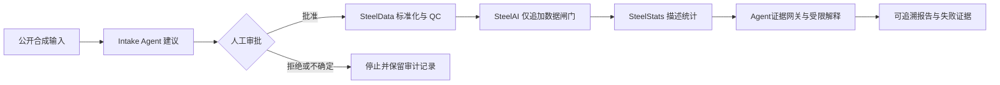

# SteelAI Workbench v0.2 Release Candidate

[](docs/INSTALL.md)
[](.github/workflows/steelai-quality.yml)
[](LICENSE)
[](config/release_candidate_v0.2.json)

[English README](README.en.md)

一个面向耐磨钢课题的本地科研 AI 工作台：Python 负责可复现的数据处理与物理计算，云端模型只负责在证据约束下组织自然语言报告。生活管理不在本项目范围内，继续放在 Notion。

本机真实资料路径只保存在被 Git 忽略的 `config/settings.toml` 中，仓库只保留 `config/settings.example.toml`。B/R processed 摘要仍来自 v0.1 已核对研究笔记并受其证据边界约束；阶段一 T10 另外完成了一批脱敏 DQ 逐试样拉伸结果的结果包、重放和暂存预检，但尚未提交正式长表。T11 已在 SteelData 中把可公开的真实格式特征转成合成回归测试。T12 已冻结个人毕业主线数据契约 v1，明确材料、炉次、研究条件、物理试样、报告和逐值观测的关系；现有入库门禁不变。

## 当前状态与项目治理

SteelAI Workbench 现在把“外部文件标准化入库”作为数据入口首页：CSV、TSV 或 XLSX 先完成人工字段映射和明确单位换算，再复用共享治理内核仅追加进入标准数据层。T71 又为 `ZHT.A*` 热模拟曲线增加专用只读解析、逐 interval QC、计划—实测对照以及运行表/曲线点表预录入；单位、试样身份或计划冲突未解决时不会正式写入。原“标准表导入”和“SteelData 标准化接入”保留为高级入口。SteelData v0.2 通过独立 Python 环境、CLI 与结果契约接入拉伸逐试样观测；其他未登记曲线仍只预览。T23 已接通人工批准后的受控执行，但正式长表仍要用户核对样品对应并确认追加。T24 的 40 个脱敏 Intake Agent 案例标签已获确认并冻结；参考分数仍不代表云模型能力。T33 已接通独立 SteelStats：用户人工确认统计身份后可生成可追溯描述统计报告，结果不回写 SteelData。T40 的公开合成一键旗舰演示已由项目负责人观看验收并冻结为 Done。T50/T51 已冻结并实现共享科研治理内核；T52–T56 已覆盖数据接入、Physics、统计与证据、图像和模型任务、Agent 证据网关以及统一运行与成果中心。T57 把九工作区覆盖、八类失败场景、离线降级、T40 重放和公开隐私边界冻结为 `v0.2.0-rc1` 本地候选。阶段六 T60 新增五角色受控科研编排；T61 将五个研究能力封装为本地 stdio MCP 工具并建立轻量 A2A 交接；T62 又以 UCI CC BY 4.0 钢板缺陷数据完成第一套真实、CPU 轻量、可重放的传统机器学习案例。T63 已冻结人工、单智能体和多智能体的同题比较，但在 24 条真实测量完成前保持 `Review / needs_human`，不宣称效率优势。T64 已整理双语入口、能力—证据映射、演示脚本、面试清单和可追溯发布准备包；全新环境复现、视频、技术报告、简历定稿和最终公开审查仍需人工完成。它们均不会给 Agent 审批、正式写入或任意命令权限。自动化任务完整治理适配被明确延期，Git 提交和标签等待项目负责人决定。DSH 是只读/建议旁路，不替代确定性数据处理，也没有审批、执行或写入权限。

当前真实热模拟批次已通过负责人确认和治理门禁，正式接入 18 条运行记录与 14,352 个曲线点；后续新批次仍必须重新完成单位、身份和偏差审批。

T86 是**可选、可关闭**的 CALPHAD 相分数功能。第一阶段已接入物理计算页；第二阶段按负责人批准把 `pycalphad==0.11.2` 装入独立环境 `.venv-pycalphad`（34 个包全部哈希锁定，主应用仍不导入它）并从 TU Wien 官方来源取得 MatCalc `mc_fe v2.062`（SHA-256 `aa02077e…`，**ODbL 1.0 + DbCL 1.0，与 pycalphad 的 MIT 相互独立，且不随本仓库分发**）；pycalphad 0.11.2 无法解析该原件（第 180 行 `REFERENCE_ELEMENT` 等 MatCalc 扩展不在 TDB 文法内）。第三阶段按负责人决定**不自行预处理原件**，改登记第三方社区派生候选 `mc_fe_v2062_clean`（提交 `19b1164…`，SHA-256 `7cf37dd4…`，上游 ODbL/DbCL 原样保留）。该候选**未修改**，差异审计为"仅语法修复、0 条未解释差异"，上游 5 个二元体系 15 项检查 **15/15** 复现、项目相关检查 **18/18** 通过；**但本机 pycalphad 0.11.2 对组元列表长度 ≥14 的体系无法求解（实测上界 13，在 pycalphad 自带数据库 COST507 上同样复现），而 B-DQ 与 R-DQ 都需要 16 个组元条目**，因此真实炉次仍算不出结果。**没有删除任何关键字、没有改写数据库、没有制作"兼容版 TDB"、没有为迁就求解器而静默丢弃组元或裁剪相列表**，T86 保持 `Blocked`。受控元素排除政策（R-DQ/B-DQ 的 As/Sn/Sb 与 O/W，逐条枚举、无通用忽略开关）与"缩减成分体系 + BCC_B2/HMVA/MC-MX 模型损失"限制声明已嵌入页面、Markdown、JSON 与 CSV 导出。

第四阶段按负责人批准建立**固定、版本化**的缩减成分体系 `steel_matrix_equilibrium_v1`（12 组元：`Fe, C, Mn, Si, Cr, Ni, Mo, Cu, Al, Nb, Ti, V`；送入 pycalphad 时另加空位 `VA`，共 13 个条目 = 本机实测容量上界）与**固定**相集合 `steel_matrix_major_carbides_v1`（`LIQUID, FCC_A1, BCC_A2, CEMENTITE, M23C6, M7C3, M6C`，独立探针 7/7 验证通过、无相被移除）。排除 `B/N/P/S`（新类别 `capacity_reduction`：**有测量值**，但为满足容量上限而排除）、`As/Sn/Sb`（数据库未覆盖）、`O/W`（无测量值，**不按 0**）。**没有任何通用元素/相选择开关**：成分与政策不一致即 `CALPHAD-COMP-012` 阻断，相缺失即 `CALPHAD-PHASE-001` 阻断，真实运行缺少具名批准即 `CALPHAD-COMP-011` 阻断（**代码不代填姓名**）。结果统一命名为 `12-component reduced-system matrix equilibrium prediction`，并强制携带缩减成分体系、排除元素及原因、BCC_B2/HMVA/MC-MX 模型损失、版本与哈希、待人工复核、不写回、非完整相图。

**十步验证结果**：第 1–5、9 步通过；**R-DQ 全部 54 个温度点收敛**（相分数合计 0.9999999998–1.0000000004，重复运行最大绝对差 3×10⁻⁹，稳定相组合逐点一致，形态为铁素体+渗碳体 → 铁素体+奥氏体 → 奥氏体 → δ 铁素体+液相 → 液相）；**但 B-DQ 在 875 °C 的多温度批量求解不收敛**（已实现有界单点重算，重算后仍未收敛；同一请求在不同进程中分别出现 0/1/2/3 个未收敛点，`pdens` 500–8000 均无法消除），因此**第 6 步失败，T86 保持 `Blocked`，不标记 `pilot_ready_pending_scientific_review`**。

本轮还发现并修复一个会让**错误结果通过合计检查**的缺陷：组元列表缺少空位 `VA` 时 pycalphad **不报错**，而是返回物理错误的结果（B-DQ 在 400 °C 报 LIQUID 0.97），相分数合计却仍是 0.99942。worker 现已在数据库声明 `VA` 时总是加入，并输出 `pycalphad_components`；验证脚本新增物理合理性检查（1000 °C 以下不得出现液相、1500 °C 以上必须出现液相、700 °C 以下必须有基体相）。**没有**删除温度点、放宽判据或改写 TDB 来"通过"验证。

第五阶段把正式路径改为**每个温度点独立进程求解**：`solver_mode=independent_single_point_process_v1`（每个温度点一个全新 worker 进程、每进程只解一个温度、**严格串行**、无热启动；输入除温度外逐点相同），旧的批量热启动路径降级为 `diagnostic_only` 仅作诊断。每个点保存完整契约（请求哈希、worker PID/退出码、`VA` 是否存在、数据库 SHA-256、求解状态、活跃相与摩尔分数、相分数合计、运行时间、脱敏 stderr、是否首次成功、求解模式），运行带独立点清单与完整性哈希 `manifest_digest`；**缺少任何点时不输出部分正式曲线**，1 次诊断重试**不会**把失败点改成通过、也**不会**拼进正式曲线。政策逐条禁止删除失败点、改步长、插值、平滑、动态增删组元或相、按结果调整 `pdens`、挑选成功的一次、用前一点作下一点初值。

**第五阶段验收结论仍是 `blocked`**：324 个独立点中 **320 个首次成功（98.77%）**，**4 个失败点全部是 B-DQ 的 875 °C 与 900 °C**（诊断重试也失败），无 native abort、`MemoryError` 或超时；R-DQ 三轮全部 54/54，三轮最大重复差 1.3×10⁻⁹。决定性证据是**全新进程**中重复求解同一单点条件——B-DQ 900 °C 成功 1/8、875 °C 成功 2/4——失败形态为"没有任何相摩尔数"。这修正了第四阶段"失败来自批量热启动"的判断：该体系在本机 pycalphad 0.11.2 下于 α/γ 相界附近**本身求解不确定**，与求解模式无关。另有第二阻断项：R-DQ 批量模式与独立点模式在 675 °C 的共同收敛点上相差 **1.069×10⁻⁴**（容差 1×10⁻⁷），两种模式得到相同三相组合但相分数不同；按"不得自行取舍"的规则，**两条曲线都不发布**。因此 **T86 保持 `Blocked`，不标记 `pilot_ready_pending_scientific_review`**。总运行时间 4013 秒（约 66.9 分钟）。

**最终状态（双状态）**：工程与作品集状态 `portfolio_exploration_complete`（已由负责人 **世道** 于 **2026-09-25**（Asia/Shanghai）签署，范围 `portfolio_engineering_acceptance_only`，记录 `config/calphad_owner_acceptance_v1.0.json`）；真实科研状态 `scientific_use_blocked_by_solver_stability`。**签署只覆盖公开合成演示的工程与作品集验收**：`scientific_use_approved=false`、`real_sample_curves_published=false`、`materials_conclusion_approved=false`，不得解释为真实钢种计算审批或科研结论批准。公开合成演示（Fe–C，25 点，独立单点进程）两次运行**最大差 0.0**，页面可展示曲线并下载 Markdown/JSON/CSV；真实 B-DQ/R-DQ 计算不发布曲线、不形成材料结论。

- [当前能力与旧入口状态](docs/CURRENT_CAPABILITIES.md)
- [毕业主线数据契约 v1](docs/GRADUATION_DATA_CONTRACT_V1.md)
- [第三方开源复用登记](THIRD_PARTY.md)
- [T14 Frictionless 可选适配器](docs/T14_FRICTIONLESS_ADAPTER.md)
- [T86 作品集总结：开源计算热力学探索（中英）](docs/T86_PORTFOLIO_SUMMARY.md)
- [T86 CALPHAD 相分数（可选、可关闭）](docs/T86_CALPHAD_PHASE_FRACTION.md)
- [T86 第二阶段：独立环境、数据库来源与兼容性门禁](docs/T86_PHASE2_ENVIRONMENT_AND_GATES.md)
- [T86 第三阶段：社区兼容版数据库候选审查与兼容性验证](docs/T86_PHASE3_COMMUNITY_COMPATIBILITY.md)
- [T86 第四阶段：固定缩减成分体系与固定相范围](docs/T86_PHASE4_REDUCED_SYSTEM.md)
- [T86 第五阶段：每个温度点独立进程求解](docs/T86_PHASE5_INDEPENDENT_POINTS.md)
- [T86 耐磨钢 CALPHAD 数据库候选审查](docs/T86_CALPHAD_DATABASE_CANDIDATE_REVIEW.md)
- [CALPHAD 数据库本地获取说明](model_lab/calphad/README.md)
- [T20 DSH × SteelData v0.2 预览接入](docs/T20_DSH_STEELDATA_V02.md)
- [T21 映射建议契约与状态机](docs/T21_MAPPING_SUGGESTION_STATE.md)
- [T22 SteelData 映射建议人工审批](docs/T22_STEELDATA_HUMAN_REVIEW.md)
- [T23 人工批准后的执行与接入](docs/T23_APPROVED_EXECUTION.md)
- [T24 Intake Agent 固定评测集](docs/T24_INTAKE_AGENT_EVALUATION.md)
- [T33 SteelStats 模块接入](docs/T33_STEELSTATS_INTEGRATION.md)
- [T40 端到端旗舰演示](docs/T40_FLAGSHIP_DEMO.md)
- [系统架构](docs/ARCHITECTURE.md)
- [从零安装](docs/INSTALL.md)
- [已知限制](docs/KNOWN_LIMITATIONS.md)
- [T41 公开仓库候选说明](docs/T41_PUBLIC_REPOSITORY_CANDIDATE.md)
- [T50 全局科研治理规范](docs/T50_GLOBAL_RESEARCH_GOVERNANCE.md)
- [T51 共享科研治理包](docs/T51_GOVERNANCE_CORE.md)
- [T52 数据接入与 Physics Engine 治理适配](docs/T52_DATA_PHYSICS_GOVERNANCE.md)
- [T53 可追溯统计与证据验证治理适配](docs/T53_STATISTICS_EVIDENCE_GOVERNANCE.md)
- [T54 EBSD SEM 与模型任务治理适配](docs/T54_IMAGE_MODEL_GOVERNANCE.md)
- [T55 Agent 证据网关](docs/T55_AGENT_EVIDENCE_GATEWAY.md)
- [T56 统一运行与成果中心](docs/T56_RUN_AND_RESULTS_CENTER.md)
- [用户操作指南](docs/USER_GUIDE.md)
- [T57 全系统回归与版本冻结](docs/T57_VALIDATION_REPORT.md)
- [T60 材料科研多智能体框架](docs/T60_MULTI_AGENT_ORCHESTRATION.md)
- [T61 MCP 工具层与轻量 A2A 协作](docs/T61_MCP_A2A_PROTOCOL.md)
- [T62 UCI 真实钢板缺陷数据案例](docs/T62_REAL_DATA_CASE.md)
- [T63 人工与智能体流程评估](docs/T63_AGENT_WORKFLOW_EVALUATION.md)
- [T64 岗位作品集与公开发布包](docs/T64_PORTFOLIO_RELEASE.md)
- [T70 外部文件标准化入库](docs/T70_EXTERNAL_DATA_STANDARDIZATION.md)
- [T71 热模拟仪器曲线标准化接入](docs/T71_THERMAL_SIMULATION_INTAKE.md)
- [T72 热模拟曲线可视化](docs/T72_THERMAL_CURVE_VISUALIZATION.md)
- [T73 Double-hit 文献口径曲线处理](docs/T73_DOUBLE_HIT_LITERATURE_PROCESSING.md)
- [T74 热模拟特征表](docs/T74_THERMAL_SIMULATION_FEATURE_TABLE.md)
- [T75 双道次软化方法选择门](docs/T75_SOFTENING_METHOD_DECISION.md)
- [双道次软化实验可追溯分析流程](docs/THERMAL_SOFTENING_CASE_WORKFLOW.md)
- [隐私与版本边界](docs/PRIVACY_BOUNDARY.md)
- [阶段零测试基线](docs/BASELINE_2026-09-04.md)
- [开发任务看板](TASKS.md)
- [变更记录](project_log/CHANGELOG.md)

## 工作台导航

侧栏保留六个主入口；每个工作区顶部只显示一个“当前功能”选择器，并在旁边说明用途：

1. 科研总览
2. 数据与物理（样品比较、物理计算、数据接入与质控、可追溯统计）
3. 研究助手（科研会话、研究任务、智能助手、助手评测、旗舰演示、证据验证、运行与成果）
4. 组织与证据（证据索引、EBSD 分析）
5. 模型与自动化（模型实验室、任务与结果）
6. 成果与作品集

底层功能视图保留独立代码和测试，但不再占用侧栏入口。

四个技术工作区统一显示领域工作路径；每个复杂功能页按“当前状态 → 主要操作 → 结果 → 技术详情”组织，并在页尾提供与当前结果相匹配的“下一步”按钮。跨工作区入口使用显式模块链接，避免跳转后落到错误功能。

## 架构概览



核心原则是 AI 只建议、人工保留决定权、确定性代码执行并留下可验证证据。详细职责和数据边界见 [系统架构](docs/ARCHITECTURE.md)。

## Research Case Pipeline v0.7

“研究助手 → 端到端研究任务”把B/R processed数据检查、Physics Card、AutoDimple、双尺度EBSD、证据验证和可选DeepSeek综合串成一次可复现运行。每次完成后生成：

- `research_report.md`：区分事实、判断、假设、禁止表述和下一步行动。
- `evidence_snapshot.json`：本次运行实际读取的脱敏结构化结果。
- `run_manifest.json`：数据/代码哈希、阶段状态、Agent轨迹、科学就绪度和隐私声明。

输出保存在`outputs/research_cases/<run_id>/`。当前仅允许B-DQ/R-DQ核心案例；1–14号实验仍保持排除。关闭外部Agent时，全部确定性阶段仍可离线完成。

## Agent Evaluation & Observability v0.9

“研究助手 → Agent评测”提供25个固定问题，覆盖数据事实、Physics、EBSD、SEM、科学边界以及隐私与权限六类能力。评分完全由透明Python规则完成，包括：

- 任务状态是否符合预期；
- 是否调用预期只读工具及正确参数；
- 是否包含必要证据概念；
- 是否触发禁止科学表述；
- 是否泄露本地路径或原始文件名；
- 延迟、工具数和API token用量。

实时评测建议每轮选择1–5题，结果写入`outputs/agent_evaluations/<evaluation_id>/`，包括逐题JSON、Markdown评测报告、评测Manifest、脱敏Trace JSONL和可观测性摘要。本地路径或原始CTF/TIF文件名会在API调用前阻断。

评测中心会保留每轮模型、案例、得分、延迟和Token历史；两轮包含共同案例时，可自动标出能力退化、改善以及成本变化。Trace不保存问题、回答、工具参数、本地路径或原始文件，可作为后续接入MLflow/OpenTelemetry的安全中间层。

## Research Data Contract v0.10

“数据与物理 → 数据质量与扩展准备”使用机器可读契约检查成分、工艺、组织、性能和物理实测/校正数据。它同时保留当前摘要表与未来长表：

- `process_steps.csv`：逐道次、逐工序记录；
- `microstructure_observations.csv`：方法、视场、尺度和指标记录；
- `property_observations.csv`：独立试样级性能记录；
- `physics_observations.csv`：实验值、模型值、校正值和残差。

这些长表尚未创建时只显示“未开始”，不会用0、经验公式或AI输出填补。当前B/R数据通过结构契约，但仍被判定为`directional_evidence_only`，因果推断和机器学习保持未就绪。

本地已准备GitHub Actions质量门禁：每次提交自动运行数据契约、25题Agent评测契约、隐私规则和完整离线测试。CI只使用`data/examples/`中的明确合成数据，不需要API密钥，也不读取真实processed数据或原始实验文件。公开仓库发布仍需单独进行脱敏审计，当前没有向GitHub上传任何资料。

## SteelData 模块接入 v0.14

入口：**数据与物理 → 数据质量与扩展准备 → SteelData 标准化接入**。

- 原有 CSV 入口保留为“标准表导入”，手工整理好的五类长表仍可导入。
- 新入口可调用同级 `SteelData` 的独立 Python 环境，或读取已有 v0.2 结果包；不在 SteelAI 环境中安装 pyjanitor/Pandera。
- 首版接通拉伸结果 → `property_observations.csv`，一条试样记录变成 YS、UTS、EL 三条观测；必须人工对应 `sample_id`，保留原 `specimen_id`。
- 合成数据、partial/failed、QC failed/needs_review、未知/重复样品和不明确单位不能入库。T71 热模拟曲线在人工确认单位、试样映射和计划偏差后，可在共享锁下事务式追加运行表与点表，并生成治理审计包。
- 两路共用最终入库闸门，提交前重检并加写入锁；保存接入审计和逐单元格来源，不自动覆盖旧性能摘要、生成统计结论或改动 DSH。
- 人工批准单条映射建议后可自动执行 SteelData；执行状态、幂等键、尝试记录和审批审计链均可核验。执行完成不会自动写 `data/processed/`。
- 阶段一 T10 已用一批人工批准的脱敏 DQ 结果验证 6 个试样到 18 条性能观测的完整预检；本地暂存状态为 `not_committed`，正式 `property_observations.csv` 仍需另行确认。

操作步骤、字段对应、代码分工和扩展边界见 [docs/STEELDATA_INTEGRATION.md](docs/STEELDATA_INTEGRATION.md)。

## Governed Data Intake v0.14

“数据与物理 → 数据质量与扩展准备”保留当前状态、模板与编号规则和标准表导入，并在 v0.14 增加 SteelData 标准化接入。T52 起，手工标准 CSV 与 SteelData 结果包都先生成确定性建议/预检，再要求具名审核人、说明和当前内容摘要绑定的批准，最后才进入同一仅追加写入闸门。

当前提供五类长表入口：

- `composition_observations.csv`：逐元素/逐炉次成分观测；
- `process_steps.csv`：保留真实顺序的逐道次/逐工序记录；
- `microstructure_observations.csv`：逐方法、逐视场、逐尺度组织指标；
- `property_observations.csv`：具有真实`specimen_id`的性能记录；
- `physics_observations.csv`：区分实验值、模型估算与校正估算。

导入闸门会拦截缺少必要列或必要值、非有限数值、未知单位、重复主键、现有记录冲突、未登记样品、超出B/R范围、未知列和非法`measurement_type`。未知单位进入 `needs_human`，在单位登记并重新预检前既不生成标准化暂存结果，也不能进入统计。系统不覆盖已有主键，不把空白改成0，不复制上传的原始文件，也不调用DeepSeek。成功写入会在`outputs/governed_data_intake/<governance_intake_id>/`生成规范化快照、审批与状态记录、提交结果和可验证 Governance Manifest；旧 `outputs/data_intake/` 仅保留历史兼容。

编号规则明确区分材料、炉次、工艺批次、研究样品、物理试样、图像视场、观测值和模型运行。视场嵌套于试样，不能冒充独立试样；无法核实的编号必须保留为待核验状态。

## Governed SteelStats v0.15

入口：**数据与物理 → 可追溯统计**。Workbench 先校验完整 SteelData 结果包，再要求用户逐一确认试样到研究样品的对应、填写实验方法版本和人工审核身份。只有这些条件齐全，才会生成冻结的 SteelStats T30 输入包。

SteelStats 保持同级独立项目和独立 `.venv`。Workbench 不导入其内部 Python 代码，只调用 `steelstats.module.json` 声明的固定 `report` 与 `verify-report` 命令。定位解析顺序：显式 `SteelStatsClient(project=...)` 优先；其次读取现有 `load_settings()` 的 `tools.steelstats_project` 字段（相对路径按 Workbench 根解释，本机真实路径只写在被 Git 忽略的 `config/settings.toml`，公开 `settings.example.toml` 保持空值）；仅"未配置"（字段缺失/空/空白）时保留旧的同级 `../SteelStats` 查找兼容。**配置存在但不可用**（设置读取/解析失败、`[tools]` 非表、字段非字符串）按关闭式失败处理：构造不抛出、`availability()` 报 `config_error`、调用给出可操作的未就绪原因，不悄悄回落到同级查找，也不在错误中回显配置内容。T40 演示身份（`demo_identity`/`_code_fingerprint`）同样跟随实际被调用客户端实例的 project 根读取模块 descriptor 并枚举包源码，键保持 `SteelData/...`、`SteelStats/...` 相对形式——manifest 与演示身份不含盘符或绝对位置，模块源码变化自然形成新 demo_id，旧演示包只增不改。T53 起，独立复核通过的结果会进一步封装到 `outputs/governed_statistics/<governance_id>/`，其中保存统计单位、逐值观测、纳入决定、方法版本、SteelData 源 Manifest 摘要、SteelStats 原始报告、证据等级、允许/谨慎/禁止表述和 Governance Manifest。

治理统计报告仍只做描述统计。描述性组间差异不会自动变成统计显著性、总体判断或因果结论；warning 必须由具名审核人显式接受。报告被修改后会变为 `invalidated`，证据验证页不再引用。任何失败都不会写回 SteelData、`data/processed/` 或原始观测。

## Governed Physics Engine v0.14

“数据与物理 → Physics Engine”现在使用本地统一模型注册表，覆盖 Ms、Ac1、Ac3、Tnr、Ceq 和 Pcm 六个模型族及 10 个现有公式版本。每个版本登记模型ID、版本、公式、文献来源、必要输入、输出单位、适用范围、范围依据、限制、许可说明、审核状态、实验对照接口、残差约定和校正状态。

- 每个模型族可选择公式版本；默认卡片仍保持六个目标物理量。
- 缺少必要成分时跳过计算，不把未知值按0代填。
- 超出登记范围时保留结果但显示适用性警告。
- 保存结果必须具名复核；适用范围警告必须显式接受，否则停在 `needs_human`。
- 模型卡和版本对比报告可直接在页面查看/下载。
- `physics_observations.csv`存在匹配实验记录时，页面按“模型值 − 实验值”只读展示实验值、模型值和残差；没有实验记录时不生成伪值。
- 校正结果不得覆盖原始公式，所有公式输出仍是经验估算而非实验真值。

正式保存会在 `outputs/physics_runs/<run_id>/` 发布输入成分快照、六个公式 ID/版本/适用范围、模型卡、实验对照、残差定义、审批与状态记录以及 Governance Manifest。相同输入和公式组合幂等复用；包被改动后标记为 `invalidated`，系统拒绝覆盖。

Research Agent和端到端研究任务调用同一注册表的六个默认模型，不再根据旧项目路径是否可用切换计算口径。质量门禁会同时校验模型注册表结构。

## Governed EBSD SEM and Model Tasks v0.16

入口：**组织与证据 → EBSD 分析**以及**模型与自动化 → 模型实验室**。两个页面共用 T54 治理面板，把任务配置、独立环境运行和人工复核分成三个明确步骤。

- 运行前登记来源编号、样品、物理试样、图像视场、模态、软件版本、模型或流程版本、参数和独立环境版本。
- 治理包只保存来源和输出的 SHA-256、大小及私有定位摘要；不复制原始 TIF、CTF、模型权重或重型输出。
- `completed` 和 `partial` 结果默认停在 `needs_human`；`failed`、`canceled`、重跑次数和前序运行引用均稳定保存。
- 部分结果只有在人为选择 `warning_accepted` 并记录范围与局限后才能登记；完整结果也必须由具名审核人接纳。
- 接纳后的结果等级仍是 `model_result`、证据类别仍是 `model_output`，不能冒充实验测量或自动科学结论。
- MATLAB/MTEX、micro-sam 及其他重型工具继续留在独立环境，Workbench 只登记配置、状态和摘要。

任务、运行和复核包分别保存在被 Git 忽略的 `outputs/image_model_tasks/`、`outputs/image_model_runs/` 与 `outputs/image_model_reviews/`。所有包均有 Governance Manifest 和完整性标记，篡改后自动失效且不会被覆盖。

## Agent Evidence Gateway v0.17

入口：**研究助手 → 智能助手**。T55 在 OpenAI 与 DeepSeek 两条云模型适配器前设置同一个关闭式证据网关：样品和 Physics 工具必须通过 T52 数据契约，EBSD/SEM 必须引用 T54 已人工复核且完整性有效的结果。工具返回先删除路径、文件名和私密字段，再扫描受保护文件名及疑似密钥，并为允许发送的载荷分配 `AGEVID-*` 证据身份。

每次调用前，页面显示不含问题原文的发送摘要；每次运行后，`outputs/agent_gateway/` 中生成只含哈希、证据引用、模型身份、Token、调用状态和权限边界的仅追加审计包。回答固定整理为“已确认事实、当前判断、待验证假设、证据与局限、下一步行动”，只能手动保存为待人工复核草稿，不能直接成为批准记录、正式数据或科研结论。无 API Key 时整个确定性系统继续离线运行。

## Unified Run and Results Center v0.18

入口：**研究助手 → 运行与成果**。T56 只读聚合 T52–T55 的治理包、科研会话、自动化任务和 T40 冻结演示，统一显示进行中、待人工确认、被阻止、完整性失效、已完成和已验收成果。每条记录只显示项目相对结果位置，并提供返回正确来源模块的下一步入口；中心不执行任务、不修改审批或覆盖结果。

Career Portfolio 不再按普通事件数量生成成果。只有完整性通过、状态为 `complete`、结果等级合格且存在具名人工接纳的治理结果才能进入；Agent 回答、科研会话、自动化状态、draft、needs_human、blocked 和 invalidated 均排除。T40 旧演示另需通过固定完整性检查和显式合成演示验收登记，且只能表述工程能力。

## v0.2.0-rc1 冻结候选

T57 用 `config/release_candidate_v0.2.json` 固定九工作区覆盖矩阵、八类跨模块回归场景、三类离线降级和零失败/零隐私发现门槛。数据、Physics、统计、图像与模型、研究助手、科研会话和作品集达到阶段目标；现有自动化任务只保留状态展示，不得产生已验收作品集成果。

### T60 材料科研多智能体协作

入口：**研究助手 → 多智能体协作**。规划、数据、统计与物理、材料解释、审查五类角色按固定契约交接。计划与结果分别经过具名人工关口；审查角色能阻止无证据主张，但不能代替人批准。工具只允许调用白名单，失败只重试一次；云模型不可用时，确定性数据、统计与 Physics Card 仍可运行。`Run_T60_MultiAgent_Demo.cmd` 可重放成功、证据不足、工具失败和离线成功四条公开合成演示。

### T61 MCP 工具与轻量 A2A

同一“多智能体协作”页面提供协议状态和结构化交接演示。五个工具具有闭合输入 Schema、角色权限、超时、稳定错误码、输入版本和幂等收据；工具结果始终是待人工复核候选。A2A 任务信封按修订绑定发送角色、接收角色、证据引用、状态、时间和结果摘要。`Run_T61_Protocol_Demo.cmd` 可运行协议自检与公开合成交接；实现范围仅为本地 stdio 和项目内任务信封。

### T62 公开真实钢板数据案例

入口：**模型与自动化 → 真实数据案例**。项目使用 UCI `Steel Plates Faults`（ID 198，CC BY 4.0）验证七类缺陷分类：固定数据摘要和 60/20/20 划分，以多数类为基线，只用验证集选择 CPU 距离加权 kNN 的 `k`，最后一次报告测试 accuracy、balanced accuracy 和 macro F1。原始数据不进入仓库或结果包；数据卡、模型卡、预测、错误分析、中文报告和 Governance Manifest 可追溯。双击 `Run_T62_RealData_Case.cmd` 可从官方地址一键重放，不需要 GPU、本地 AI 或云模型。

### T63 人工与智能体流程评估

入口：**研究助手 → 多智能体协作 → 人工 单智能体与多智能体评估**。四项固定任务覆盖数据检查、统计解释、Physics 判断和报告整理；三种流程各重复两次。系统已冻结完成率、关键错误、人工修订、耗时、Token、费用、追溯完整率和优势判定，并可生成测量模板与仅追加评估包。双击 `Run_T63_Benchmark_Prep.cmd` 可准备评测；当前只完成结构校准，24 条真实测量齐全前结论固定为 `insufficient_evidence`。

### T64 岗位作品集与公开发布包

入口：**成果与作品集 → T64 岗位作品集与公开发布包**。项目已固定 16 项公开资产、4 条能力—证据映射和八项发布门槛，补充英文 README、三分钟演示脚本与五类面试讲解。双击 `Run_T64_Portfolio_Prep.cmd` 可生成仅追加发布检查包；该包保持 `needs_human`，不会自动提交 Git、创建 Release 或把 T63 未测结论升级为成果。

Windows 完整研发环境可双击 `Freeze_v0.2_Candidate.cmd`，依次验证候选契约、质量门禁、全量离线测试、T40 合成旗舰演示和公开候选审计。该脚本不执行 Git 提交、标签或远程发布。

## Research Session & Daily Workflow v0.13

“研究助手 → 科研会话”把日常科研问题保存为可继续的本地结构化会话。当前提供五个固定模板：B/R综合任务、新增数据质量检查、Physics实验校正、EBSD双尺度比较和SEM断口分析。

每个会话记录研究问题、B/R样品范围、模板版本、阶段状态、事实/判断/假设/局限、下一步行动和相对运行引用。科研总览显示进行中、阻塞和开放行动；端到端B/R任务完成后会自动关联当前会话并更新对应阶段。

- 会话采用独立JSON文件和修订号，写入时使用原子替换，避免半写入状态。
- 会话只能登记B-DQ/R-DQ，1–14号实验继续由契约排除。
- 标题、问题和记录中不接受本地绝对路径或原始CTF/TIF文件名；原始资料仍通过只读目录和证据索引管理。
- 完成会话时只向项目事件日志写入结构化摘要，便于后续Career Portfolio提取。
- Research Session Contract已经加入离线质量门禁；不存在真实会话时也可只验证五个模板契约。

## 科研工作台（React 六页 + 薄 API，WO-31）

2026-10-13 新增。原来的 Streamlit 入口**保持不变**（见下一节）；这一层是同一批工具之上的
React 六页工作台，用薄 API 把"选项目/任务 → 导入资料 → 跑已有工具 → 看真实结果 → 下载"串起来。
它**不重写任何科学算法**，也不新建云 Agent。

### 启动 / 停止 / 准确 URL

| 入口 | 命令 | URL |
| --- | --- | --- |
| React 六页 + 薄 API | 双击 `Start_Research_Workbench.cmd`（可选端口参数，默认 8760） | <http://127.0.0.1:8760/> |
| 科研 Streamlit 原页 | 双击 `Start_Research_Streamlit.cmd`（默认 8761） | <http://127.0.0.1:8761/> |

两个服务都**只监听回环地址**；`Ctrl+C` 或关闭窗口即停止。端口被占用时薄 API 会明确报
"端口已被占用"并以退出码 3 结束，**不做全机端口扫描**，也不自动换端口。

薄 API 需要独立环境（不污染冻结的科学计算环境）：

```powershell
py -m venv .venv-web
.venv-web\Scripts\python.exe -m pip install -r requirements-web.txt
cd frontend; npm install --ignore-scripts; npm run build; cd ..
.venv-web\Scripts\python.exe -m steelai.web_api --host 127.0.0.1 --port 8760
```

`frontend/dist` 缺失时薄 API 只提供 `/api/*`；`/api/health` 会如实报告 `frontend_built`。

### 真实输入到导出

1. **项目页**：项目清单直接读现有科研登记（科研主表 `项目表` 工作表），不新建第二个总项目库；
   任务落在既有的 `03_工作区/<项目>/<任务>/` 结构里（`TASK.md`、`inputs/`、`runs/`、`handoff.md`）。
2. **资料页**：上传到本任务 `inputs/`，可只读预览（表头/单位/分隔符/图像尺寸）。上传名会被
   服务端规整为单一文件名，拒绝 `../`、盘符、NTFS 数据流、Windows 设备名与未登记类型。
3. **数据处理页**：SteelData `preview` 只读；`run` **必须**提供显式人工审批文件（缺审批直接拒绝，
   不自动改绿）；`demo` 只跑仓库自带合成 fixture，坏值按原合同 `QCfailed`；`verify` 校验完成标记与产物校验和。
4. **分析工具页**：SteelStats 描述统计报告 + 报告包校验；Micro-SAM 单图点/框分割（坐标是**原像素**）；
   CALPHAD 缩减体系平衡相分数（温度 K/C、显式组元/相，`VA` 由脚本自动加入、手写会被拒绝）。
5. **成果页**：列出本任务产物（含 SHA-256）与直接下载；候选晋升需要**具名人工审批人**，
   且正式晋升流程未接通时如实返回"未接通"，不假装成功。
6. **工作记录页**：参数、退出码、用时、产物与接手摘要 `handoff.md`；另一个 AI 读同一 README、
   同一任务目录与这份摘要即可接续。

### 产物位置

| 内容 | 位置 |
| --- | --- |
| 每次运行的输出 | `<工作区>/<项目>/<任务>/runs/<run_id>/`（薄 API 的运行根默认在 `outputs/research_web/`） |
| 任务说明与接手摘要 | `<工作区>/<项目>/<任务>/TASK.md`、`handoff.md` |
| 合成演示项目（隔离） | `<工作区>/PSYN_合成演示/`（只用于本批隔离测试） |
| React 构建产物 | `frontend/dist/`（被 Git 忽略，`npm run build` 重建） |

### 工具依赖与"改哪一层"

- 科学算法**不在这里**：SteelData / SteelStats / Micro-SAM / CALPHAD 各自保持独立环境与固定 CLI 合同，
  薄 API 只做可信解析 + 固定 argv 构造（`shell=False`，客户端不能提交路径/URL/解释器/shell）。
- 要改界面：`frontend/src/`；要改接口或工具接线：`steelai/web_api/`；要改科研 Streamlit 入口：`research_app.py`。
- 工具解释器与机器专用路径**只在被忽略的 `config/settings.toml` 里登记**，提交的代码里没有本机盘符；
  `/api/health` 会逐个报告解释器是否已登记、是否落在已声明的可信根内。

### 限制（如实）

- 真实 B-DQ/R-DQ 炉次算例、复杂钢种与真实原件**仍未接线**：CALPHAD 只做已验证的 Fe–C 缩减小例，
  真实 B/R 科研仍 `blocked`；Micro-SAM 需要本机权重与独立环境，缺任一项该能力卡会给出具体缺失项。
- 科研 Streamlit 原页**没有实现消息协议**，因此嵌入时按普通 iframe 显示并明确标注"未绑定"，
  不把"能嵌进去"当成"数据/AI 已接通"；不可嵌时用"在新窗口打开原页"给出准确 URL。
- 薄 API 不提供人审、不做正式入库；`actor='human'` 这类字符串**不构成人审**。
- 完整旧测试套件仍非全绿（已知为环境级：WorkBuddy 沙箱 `sitecustomize` 守卫、pytest 临时目录 ACL、
  本地科研数据缺失与既有未提交生活区内容漂移），**不写"全部零回归"**；WO-31 新增模块不在该套件覆盖范围内，
  由 `Batch_WO31/logs/http_e2e.py` 与真实浏览器 `browser_e2e.js` 单独验证。

## 运行

当前工作目录若已包含 `.venv`，可直接双击 `Start_SteelAI.bat`（仓库中只有这一个 Windows 启动器）。应用只监听本机 `127.0.0.1`，不会主动暴露到局域网；若已运行，启动器会直接打开现有页面。启动器对本机健康端点做检查时会显式绕过系统 HTTP 代理，因此设置了 `HTTP_PROXY` 但没有 localhost 例外时，也能正确识别已在运行的实例，不会在 8501 上启动第二个实例。

T40 毕业作品主演示可直接双击 `Run_Flagship_Demo.cmd`。它只读取仓库中的公开合成资料，跨独立 SteelData / SteelStats 环境生成审计包，并同时验证成功案例和“未知单位被拦截”的失败案例；演示身份沿实际被调用的客户端项目根溯源（迁移后经 `tools.steelstats_project` 指向新根），同名包完整复核通过才复用、否则拒绝覆盖；详细清单见 [T40 文档](docs/T40_FLAGSHIP_DEMO.md)。

首次安装可用 Windows PowerShell：

```powershell
py -m venv .venv
.venv\Scripts\Activate.ps1
python -m pip install -r requirements.txt
streamlit run app.py
```

完整 Windows、macOS 和 Linux 从零安装及公开候选自检步骤见 [安装说明](docs/INSTALL.md)。当前范围、外部模块依赖和不能宣称的能力见 [已知限制](docs/KNOWN_LIMITATIONS.md)。

如果电脑上没有 `py`，将第一行换成已安装 Python 3.11+ 的完整路径。

应用核心不依赖网络。Research Agent默认使用DeepSeek API。请在Windows用户环境变量中配置：

```powershell
$env:DEEPSEEK_API_KEY="你的密钥"
streamlit run app.py
```

未配置密钥或未安装 `openai` 时，Agent保持离线，分析助手仍可使用离线规则报告。API 调用前请确认数据已脱敏；默认只发送当前选中样品的结构化字段，不发送图片或原始文件。

Research Agent只开放样品、Physics Card、既有EBSD、AutoDimple和证据验证摘要等七个只读工具；不允许修改数据、启动MATLAB/GPU任务或访问未登记文件。当前默认使用DeepSeek OpenAI兼容接口；保留OpenAI供应商适配，但不引入LangChain。

## DeepSeek Harness 旁路接入

DSH 不替换 SteelAI 或 SteelData 的确定性核心。项目通过本地 stdio MCP 桥接，
把上述七个已审计只读工具注册为 `mcp__steelai__*`；T20 以独立 Python 环境
注册 SteelData v0.2 预览服务，T21 增加一个只能保存结构化建议元数据的工具。
两个桥都不提供审批、批次执行或任意 Shell 工具，也不接收 DeepSeek API Key；
建议记录不能直接成为批准配置。

双击 `Start_SteelAI_DSH.cmd` 可从隔离的 `dsh_workspace/` 启动；详细边界和
首个验证提示见 `dsh_workspace/README.md`。启动脚本默认把 DSH 会话设为
`read-only`/需审批模式，不使用 `danger-full-access`。

Evidence & Validation Center当前只覆盖B-DQ/R-DQ核心案例。1–14号实验因数据质量决定暂不进入processed核心证据集、不参与统计或机器学习。中心使用L0–L4证据等级，自动区分方向性观察、证据冲突、未确认结果和因果推断禁区；Research Agent可读取脱敏验证摘要，但不会获得原始路径。

## 接入真实资料

1. 在 `config/settings.toml` 中填写现有 `02_实验数据` 和 WearSteel-AI v0.1 的绝对路径。
2. 在“数据与物理 → 数据质量与扩展准备”下载模板、填写并上传预检；不要手工覆盖`data/processed/*.csv`，也不要复制原始照片与仪器文件。
3. 在“证据与微观组织索引”页面登记图片绝对路径、模态和人工提取参数。
4. Physics Engine 会优先动态读取原 v0.1 的 13 个模型；只有路径不可用时才使用 `steelai/physics.py` 的备用公式。
5. Open Model Lab 会读取SEM同名HDR中的倍率和像素尺寸，先生成B/R同倍率小样本试验清单；不会修改或复制原始TIF。

## Open Model Lab

重型开源模型不直接安装到主应用环境。每个模型应使用独立环境，先在公开示例和小规模真实数据上验证，再通过适配器返回结果。当前首个试验为B/R DQ冲击断口的1000× SEM图片配对；页面只完成候选发现、元数据读取、预览与试验清单生成，尚未把模型输出视为科研数据。

CSV 以 `sample_id` 为关联键。空值留空，不要用 0 代替“未测”。1–14号实验继续排除；后续优先补齐B/R核心案例的逐工序、逐视场、独立试样和物理实测长表。

## 数据与证据边界

- `data/processed/`：供应用读取的结构化副本/摘要，不是原始数据真源。
- `data/index/`：原始文件路径、微观照片和证据索引。
- `project_log/events.jsonl`：应用内生成的分析、决定和里程碑事件。
- `project_log/CHANGELOG.md`：版本级变更。
- `outputs/reports/`：可复制到论文笔记或组会材料的分析报告。
- `outputs/portfolio/`：求职展示材料。

公式输出是经验估算值，不是实验真值。当前适用范围提示是工作台审查护栏，并不等同于论文作者声明的完整适用范围。

## 测试

```powershell
python -m unittest discover -s tests -v
```

核心测试不需要外部API；GitHub CI使用合成数据运行同一套质量门禁。发布前另运行：

```powershell
python -m steelai.public_release_audit
```

该命令只审计 Git 将要公开的候选内容，并对本机绝对路径、常见密钥、真实运行区、个人科研会话和模型权重关闭式失败。

本地 v0.2 候选还应运行：

```powershell
python -m steelai.release_candidate
```

完整操作顺序和失败处理见 [用户操作指南](docs/USER_GUIDE.md)，本轮测试证据见 [T57 验收报告](docs/T57_VALIDATION_REPORT.md)。
