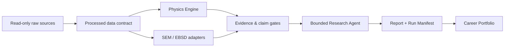

# SteelAI Workbench

[](https://github.com/shidao23/steelai-workbench/actions/workflows/steelai-quality.yml)


**SteelAI Workbench is an evidence-aware research operating system for wear-resistant steel.** It connects composition, process, microstructure, properties, empirical physics, microscopy workflows and a bounded research agent in one auditable Streamlit application.

> Public portfolio edition: every B/R record in this repository is synthetic. No raw microscopy files, industrial data, local paths, thesis text or API keys are included.

[中文说明](README.zh-CN.md) · [Data Card](docs/DATA_CARD.md) · [Model Card](docs/MODEL_CARD.md) · [Privacy Design](docs/PRIVACY.md) · [Portfolio Case](docs/PORTFOLIO.md)

**[Open the live public demo](https://steelai-workbench.streamlit.app/)**

## Why this project

Materials research often spans spreadsheets, empirical equations, SEM/EBSD results, scripts and narrative reports. SteelAI turns that fragmented workflow into a reproducible chain while keeping deterministic calculations authoritative and language models constrained by structured evidence.



## What is implemented

- Six task-oriented Streamlit areas instead of a page-per-tool interface.
- B/R composition-process-microstructure-property comparison using synthetic demo records.
- Empirical Physics Engine for Ms, Ac1, Ac3, Tnr, Ceq and Pcm with missing-input and applicability warnings.
- Versioned research data contract with append-only intake validation and explicit sample/specimen/field hierarchy.
- Read-only Research Agent with tool whitelist, local privacy blocking and offline fallback.
- 25-case deterministic Agent benchmark across grounding, physics, microscopy, scientific boundaries and privacy.
- MTEX/EBSD and micro-SAM integration contracts, kept outside the lightweight main environment.
- Evidence levels, claim gates, reproducible Research Case packages and portfolio event design.
- 54 offline tests plus a GitHub Actions quality gate using synthetic fixtures only.

## Scientific guardrails

- Missing values remain missing; they are never replaced with zero.
- Model estimates are not experimental truth.
- Image fields and segmentation objects are not independent specimens.
- EBSD acquisition scales remain separate and are never pooled silently.
- Current B/R evidence is classified as `directional_evidence_only`.
- Causal inference and machine-learning readiness remain false until independent specimen-level data exist.

## Run locally

```bash
python -m venv .venv
# Windows: .venv\Scripts\activate
# Linux/macOS: source .venv/bin/activate
python -m pip install -r requirements.txt
streamlit run app.py
```

The public configuration disables external AI and leaves MATLAB, MTEX and GPU backends unconfigured. The application still demonstrates deterministic data, physics, evidence, evaluation and reporting workflows.

## Test

```bash
python -m unittest discover -s tests -v
python -m steelai.quality_gate
```

## Public / private boundary

This repository contains reusable application code, synthetic fixtures and documentation. A separate private local deployment connects to read-only experimental sources and specialist environments. See [Privacy Design](docs/PRIVACY.md) before adapting the project to real research data.

## Technology

Python · Streamlit · pandas · deterministic validation · function calling · DeepSeek-compatible adapter · MATLAB/MTEX adapter · micro-SAM adapter · GitHub Actions

## License

The SteelAI application code is released under the MIT License. External tools and models, including MTEX and micro-SAM, retain their own licenses and are not redistributed in this repository.
