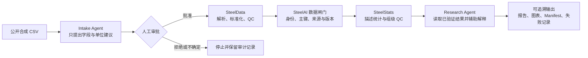

# SteelAI Workbench 架构

SteelAI Workbench 把“AI 建议”“人工决定”和“确定性处理”分开。当前毕业作品的公开主线如下：

## 模块职责

| 模块 | 负责 | 不负责 |
| --- | --- | --- |
| SteelData | 确定性解析、单位处理、标准化、逐值 QC、可重放结果包 | 人工批准、正式科研入库、统计推断 |
| SteelAI Workbench | 任务编排、审批界面、样品对应、仅追加数据闸门、结果展示 | 修改原始文件、替用户作科学决定 |
| SteelStats | 冻结输入契约、描述统计、组级 QC、可验证报告 | 回写源包、显著性检验、因果判断 |
| Research Agent | 基于已验证结构化证据组织解释与下一步建议 | 直接写数据、审批建议、把估算称为事实 |

## 关键安全边界

- 原始实验文件保持外部只读；公开仓库只包含明确标记的合成数据。
- Agent 的建议不能直接执行，必须经过人工审批；未知单位和歧义默认停止。
- 统计只读取冻结的标准化结果，输入与输出均带哈希和方法版本。
- 本地路径、密钥、运行结果、真实审批记录和模型权重不属于公开候选包。

完整可重放示例见 [T40 端到端旗舰演示](T40_FLAGSHIP_DEMO.md)。
