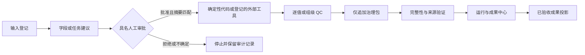

# SteelAI Workbench v0.2 架构

## 架构结论

SteelAI Workbench v0.2 把科研对象身份、AI 建议、人工决定、确定性执行、质量控制、来源追溯和完整性验证分开。所有正式结果通过共享治理内核形成仅追加产物；不确定输入停在 `needs_human`，不满足执行条件时进入 `blocked`，被未登记修改的产物进入 `invalidated`。

## 分层结构

| 层 | 主要代码 | 职责 |
| --- | --- | --- |
| 交互层 | `app.py`、`pages/`、`steelai/views/` | 展示状态、收集人工决定、提供下一步入口 |
| 工作区适配层 | `data_intake_governance.py`、`physics_governance.py`、`statistics_governance.py`、`image_model_governance.py` | 把不同科研流程映射为共享治理对象 |
| Agent 证据层 | `agent_evidence_gateway.py`、`research_agent.py` | 只释放经验证的最小结构化证据，限制工具和输出权限 |
| 共享治理内核 | `steelai/governance/` | 状态机、身份、审批、QC、来源、Manifest、哈希、仅追加发布与受控执行 |
| 统一索引层 | `run_center.py`、`portfolio.py` | 汇总状态并严格筛选具名验收成果 |
| 外部隔离层 | SteelData、SteelStats、图像和模型工具 | 使用独立环境完成确定性处理，通过固定契约返回结果 |
| 公开案例层 | `real_data_case.py`、UCI ID 198 | 固定许可、哈希、划分、基线、模型卡、错误分析与非正式治理结果 |

## 九个工作区

| 工作区 | v0.2 目标链路 | 冻结状态 |
| --- | --- | --- |
| 数据接入 | 字段识别 → 人工审批 → 标准化 → 逐值 QC → 入库 | 完成 |
| Physics Engine | 输入完整性 → 公式版本 → 适用范围 → 计算 → 残差 → 模型卡 | 完成 |
| 可追溯统计 | 统计身份 → 纳入决定 → 描述统计 → 组级 QC → 报告复核 | 完成 |
| EBSD 与 SEM | 文件登记 → 参数确认 → 外部运行 → 人工复核 → 结果索引 | 完成 |
| 研究助手 | 已验证证据 → 事实判断假设标注 → 受限解释 | 完成 |
| 模型实验室 | 数据版本 → 模型版本 → 运行参数 → 结果 → 人工验收 | 完成 |
| 自动化任务 | 任务提议 → 批准执行 → 状态记录 → 产物验证 | 延期；v0.2 只冻结状态展示 |
| 科研会话 | 研究问题 → 证据引用 → 阶段结论 → 局限 → 下一步 | 完成 |
| 作品集 | 已验收成果 → 证据投影 → 公开范围复核 | 完成 |

## 数据与权限边界

- 原始实验文件保持外部只读；Workbench 不复制或修改来源文件。
- 正式数据和结果只追加，不覆盖相同身份的既有内容。
- 人工批准绑定对象类型、对象 ID、修订号和内容摘要；Agent 不能制造人工批准。
- 云端模型只接收通过证据网关释放的最小结构化摘要，不接收原始路径、文件或密钥。
- T40 使用公开合成数据，只证明工作流和工程实现，不能冒充真实科研结论。
- 公开候选排除真实数据、运行结果、个人会话、密钥、本机路径和模型权重。
- T62 只在运行时从 UCI 读取经固定哈希验证的 CC BY 4.0 公开数据；原始数据不复制到仓库或结果包，模型候选需另行人工验收。

## 版本冻结

`config/release_candidate_v0.2.json` 固定九工作区覆盖、八类回归场景、离线降级和公开边界。`Freeze_v0.2_Candidate.cmd` 可在 Windows 上依次复核发布契约、质量门禁、全量测试、T40 和公开候选审计。Git 提交、标签和发布仍由项目负责人明确执行。

## Enterprise Lab 可选边界（T80）

`steelai/enterprise_lab/` 是一个可选扩展包，按六边形架构分为 `domain`、`application`、`ports`、`adapters` 四层，用 `typing.Protocol` 冻结 `RunRepository`、`AuditRepository`、`ArtifactStore`、`EventPublisher`、`JobQueue` 和 `UnitOfWork`，目前只有纯 Python 内存适配器。它只为后续 PostgreSQL、API、后台任务、Transactional Outbox 与 Kafka 预留稳定接口，**没有**安装或接入上述任何组件。

> **阶段说明（T85）**：本节记录的是 **T80 当时**的边界：T80 仅建立内存适配器与接口骨架。后续 **T81–T84 已补充**可选的 PostgreSQL Schema/迁移、Repository/UoW、事务型 outbox 写入侧、dispatcher 与 background job worker——它们仍是**可选模块**，默认应用依旧不导入、不连接、不自动启动，整体**不是生产平台**。全局定位与冻结结论见下文"Enterprise Lab 阶段冻结（T85）"。

边界要点：

- **可选**：`app.py`、`pages/`、科研计算、共享治理内核与运行中心都不导入该包；没有企业组件时应用仍完全离线运行，移除该包不需要迁移数据或改配置。
- **科研证据不变**：正式数据仍是 `data/processed/*.csv`，结果包仍是 Manifest + SHA-256 + `COMPLETE` 的仅追加目录；Enterprise Lab 不复制、不迁移、不重写任何既有科研产物，也不建立第二套科研状态机（运行状态直接复用 T50 的 `GovernanceState`）。
- **未来 PostgreSQL**：只先承载业务元数据（项目、运行、状态与修订、审计、artifact 引用、任务状态、outbox），科研数值仍留在 CSV 与结果包。
- **大文件**：走文件或对象存储，数据库只保存相对引用与 SHA-256；`ArtifactStore` 不承载文件内容。
- **未来 Kafka**：只承载结构化领域事件（ID、状态、版本、哈希、脱敏摘要），不用于 RPC、大文件或直接执行科研计算；接入前必须先实现 Transactional Outbox。
- **不做**：微服务拆分、Kubernetes、服务网格与云部署不在当前范围内。
- **内存适配器（T80 交付物）**：`MemoryStore.state` 始终只代表已提交状态，运行中的 UoW 只改私有 working state，commit 一次原子替换、rollback 只丢弃；同一 store 同时只允许一个 UoW（重叠会被 `ENT-UOW-001` 拒绝），UoW 关闭后其仓库句柄一律失效；运行创建与后台任务入队均绑定幂等键 + 请求摘要，同键不同内容在任何副作用前关闭式失败。这些是接口契约的演示，不是数据库事务——T82 之后可选 PostgreSQL 适配器提供了真实事务实现。

决策全文与复核要点见 `docs/enterprise/ADR-0001_ENTERPRISE_LAB_BOUNDARY.md`，实施说明见 `docs/enterprise/T80_ENTERPRISE_ARCHITECTURE_FOUNDATION.md`。

## PostgreSQL 持久化基线（T81，可选，未接入默认应用）

已建立**尚未接入**的 PostgreSQL 持久化基线：可选依赖清单 `requirements-enterprise.txt`、可选边界包 `steelai/enterprise_lab/adapters/postgresql/`、专用 Schema `steelai_enterprise` 的五张业务元数据表，以及可 upgrade/downgrade 的手写 Alembic 迁移（`alembic-enterprise.ini`、`migrations/enterprise/`）。

真实能力范围：

- 表结构：`workflow_runs`、`artifact_references`、`audit_events`、`outbox_events`、`background_jobs`，全部字段、命名 CHECK 约束与索引已定义，`audit_events` 由数据库 trigger 强制只追加；
- 迁移：`upgrade`、`downgrade`、再次 `upgrade` 已在真实 PostgreSQL 18.6 上实测通过（35 个命名约束、8 个业务索引、audit trigger/function 实测存在，SQLSTATE `23514`/`23505`/`23001` 实测）；
- 连接配置：只能来自显式参数或 `STEELAI_ENTERPRISE_DATABASE_URL`，无默认凭据，缺失时关闭式失败，所有输出经脱敏；
- 映射：`workflow_runs.state` 复用 T50/T51 `GovernanceState`，`background_jobs.state` 复用 T80 `JobState`，`DomainEvent` 以 outbox 行落库；数据库只保存运行、审计、引用、任务与 outbox 元数据，**不取代** CSV/Manifest/hash 证据包，也不代表审批通过。

尚未具备：outbox dispatcher、worker、Kafka、API 或任何默认应用接入；没有 `STEELAI_ENTERPRISE_DATABASE_URL` 时现有应用照常运行，也不存在数据库开关或页面入口。决策见 `docs/enterprise/ADR-0002_POSTGRESQL_PERSISTENCE.md`，实施与测试说明见 `docs/enterprise/T81_POSTGRESQL_PERSISTENCE_BASELINE.md`。

## PostgreSQL 持久化适配器（T82，可选，仍未接入默认应用）

在 T81 Schema 之上新增**可选**的 PostgreSQL 持久化适配器：五个 T80 Port 的 PostgreSQL 实现、把五个仓储绑定到同一连接与同一事务的 `UnitOfWork`、事务型 outbox 的写入侧，以及数据库内的任务租约。

真实能力范围：

- 仓储：`PostgreSQLRunRepository`、`PostgreSQLAuditRepository`、`PostgreSQLArtifactStore`、`PostgreSQLEventPublisher`、`PostgreSQLJobQueue`；`EnterpriseWorkflowService` 只替换注入的 `UnitOfWorkFactory` 即可运行，业务逻辑未改；
- 事务：一个 UoW = 一个连接 = 一个事务，run/artifact/audit/outbox/job 同事务提交，异常退出自动回滚，边界结束后旧句柄返回 `ENT-UOW-001`；`commit()`/`rollback()` 在边界开始前调用返回 `ENT-UOW-001`，`begin()` 或 `commit()` 失败时立即关闭连接并只抛脱敏 `ENT-DB-001`（rollback 失败也不掩盖原异常）；显式 `rollback()` 失败或"正常离开未提交的 `with` 时自动回滚失败"都会抛脱敏 `ENT-DB-001` 而非静默成功，只有 `with` 内已有异常时才保留原异常；所有仓储调用先校验 UoW 生命周期再校验参数，advisory lock 失败同样经 SQLSTATE 映射脱敏；已在 PostgreSQL 18.6 上实测"四类记录同一提交后同时可见""未提交数据对第二连接不可见""四个写入阶段注入异常后五张表回到基线"；
- 幂等与并发：`INSERT ... ON CONFLICT DO NOTHING ... RETURNING` 裁决幂等；`create_run` 先校验参数键与 run 自身键一致，不一致在任何 SQL 之前以 `ENT-IDEMPOTENCY-001` 失败；同 `artifact_id` 只有在全部持久化字段一致时才 `reused=True`，否则 `ENT-ARTIFACT-001`；`UPDATE ... WHERE revision = ? RETURNING` 做乐观并发；
- 序号与租约：全局审计序号与 per-run outbox 序号各自对应一把带 SteelAI/T82 命名空间的 `pg_advisory_xact_lock`，`count()`+`append`、`next_sequence()`+`publish` 都在同一把锁内完成取值，因此两个重叠事务**都会成功**（序号 1、2），只有直接提交陈旧/乱序序号才关闭式失败；任务租约只依赖 `FOR UPDATE SKIP LOCKED`（不取 advisory lock），两个重叠事务租到不同任务，只有一个任务可用时第二个事务立即得到 `None`；`complete`/`fail`/`retry`/`cancel` 先 `SELECT ... FOR UPDATE` 再转换，并发 `complete` 与 `fail` 只有一个成功；
- 错误映射：只按 SQLSTATE 与约束名映射到既有 `ENT-*` 代码，异常不携带 SQL、参数或连接串。

仍未具备：**Kafka、worker 服务、心跳与租约回收、HTTP API、RBAC、多租户、生产备份与高可用**。`leased` 任务不会因心跳缺失自动回收。默认 SteelAI 应用、`pages/`、Streamlit 入口与 T76 启动器都不导入该适配器，仍完全离线运行。决策见 `docs/enterprise/ADR-0003_POSTGRESQL_UNIT_OF_WORK.md`，实施与验收说明见 `docs/enterprise/T82_POSTGRESQL_REPOSITORIES.md`。

## 事务型 Outbox Dispatcher（T83，可选，仍未接入默认应用）

在 T82 的 outbox **写入侧**之上补上**派发侧**闭环：领取 → 外部发送 → 成功确认 / 失败重试 → 过期租约恢复，交付语义为 **at-least-once**。

真实能力范围：

- 接口：`ports/outbox.py` 定义不可变 `OutboxClaim`（`DomainEvent` + `claim_attempt` + `lease_deadline`）、`OutboxDeliveryRepository`（`claim_batch` / `mark_published` / `mark_failed` / `reclaim_expired`）与 `EventTransport`（`send(event, *, idempotency_key)`）；投递状态**不进入** `DomainEvent`，T80 的 `EventPublisher` 契约未改；
- 调度形态：`application/outbox_dispatcher.py` 只提供**有限调用** `dispatch_batch(limit)` 与 `reclaim_expired(limit)`——没有 daemon、没有定时器、没有长期运行进程；
- 事务纪律：领取、确认、记失败、恢复租约各是一次短事务并在发送前提交归还连接；`transport.send` **绝不在**数据库事务内执行，已在 PostgreSQL 18.6 上实测 transport 执行期间连接池 checked-out 为 0、结束无 `idle in transaction`；
- 领取与 fencing：复用 `outbox_events` 既有五列、**零迁移**；领取用 `SELECT ... FOR UPDATE SKIP LOCKED` + `UPDATE ... SET delivery_status='publishing', attempts = attempts + 1, available_at = now() + lease_seconds ... WHERE attempts = :seen_attempts RETURNING *`；`attempts` 即 fencing token，确认/记失败只在 `publishing` 且 `attempts` 匹配时生效，否则 `ENT-OUTBOX-CLAIM-001`；
- 顺序：同一 run 只领取"最小未 `published` 的 `sequence`"，前序事件 `failed` 会持续阻塞后序事件（T83 无跳过、无人工解锁）；不同 run 可并发领取；
- 失败与恢复：可重试失败回到 `pending` 并设指数退避，不可重试或 `attempts` 达上限进入 `failed`；过期租约按 `attempts` 是否达上限回到 `pending` 或进入 `failed`，固定写入 `ENT-OUTBOX-LEASE-EXPIRED`；错误码只保存安全字段（未知 transport 异常 → `ENT-OUTBOX-TRANSPORT-001`，非法配置 → `ENT-OUTBOX-CONFIG-001`，数据库异常沿用 T82 的 SQLSTATE 脱敏映射）；
- 派发结果：只有五种 status，且 `delivered` / `persistence_state_known` / `redelivery_possible` **只由 status 推导**——`published`（true/true/false）、`retry_scheduled`（false/true/true）、`failed_terminal`（false/true/false）、`sent_unacknowledged`（true/false/true，已发送但确认结果未知）、`failure_unrecorded`（false/false/true，未发送且失败也未记录，**不得报告为 delivered**）；未知 status 一律拒绝；
- 离线适配器：`adapters/outbox_memory.py` 提供与 PostgreSQL 同语义的内存投递仓储与 `RecordingEventTransport`（只在内存记录，无网络与文件 I/O；**不代表 Kafka 已接入**）；
- 公共入口：`steelai.enterprise_lab.ports`（投递契约与状态码）、`.application`（Dispatcher/Config/Outcome/状态常量）、`.adapters`（内存投递适配器与 Recording Transport）、`.adapters.postgresql`（PostgreSQL 投递适配器）；顶层 `steelai.enterprise_lab` 只导出**不需要可选 PostgreSQL 依赖**的 T83 类型，导入它不会加载 SQLAlchemy/Alembic/Psycopg。

交付语义与边界：T83 是 **at-least-once，不是 exactly-once**；transport 发送成功但数据库确认失败时事件会在租约恢复后**再次发送**，因此**下游必须以 `event_id` 作为幂等键**。仍未具备：Kafka 与任何真实 broker、常驻 worker/调度器、监控告警指标、投递查询接口与人工重放控制台。默认 SteelAI 应用、`pages/`、Streamlit 入口与 T76 启动器都不导入 T83 代码，仍完全离线运行。决策见 `docs/enterprise/ADR-0004_OUTBOX_DISPATCHER.md`，实施与验收说明见 `docs/enterprise/T83_OUTBOX_DISPATCHER.md`。

## Background Job Worker（T84，可选，仍未接入默认应用）

在 T82 的 `background_jobs` 表与 T80 任务状态机之上补上**执行侧**闭环：领取任务 → 事务外执行 Handler → 心跳续租 → 成功确认 / 失败重试 → 过期租约恢复，执行语义为 **at-least-once**。

真实能力范围：

- 接口：`ports/workers.py` 定义不可变 `JobLease`（冻结的 `BackgroundJob` + `lease_id` + `attempt` + `leased_at`/`heartbeat_at` + `worker_id`）、`JobExecutionRepository`（`claim_next` / `heartbeat` / `mark_succeeded` / `mark_failed` / `reclaim_expired`）、`JobHandler`、`JobHandlerRegistry`、`JobExecutionContext`（只含安全元数据与 `heartbeat()`）与 `JobHandlerError`；T80 `JobQueue`/T82 `PostgreSQLJobQueue` 的 `enqueue`、状态查询与状态机演练**语义未改**，执行确认不使用无 fencing 参数的 `complete`/`fail`；
- 调度形态：`application/job_worker.py` 只提供**有限调用** `run_once` / `run_batch(limit)` / `reclaim_expired(limit)`——没有常驻服务、没有无限循环、没有定时器、没有后台线程；
- 租约与 fencing：领取用 `SELECT ... FOR UPDATE SKIP LOCKED`（`queued`/`retrying`）并写入**全新** `lease_id`，第一次领取不增加 `attempts`；此后所有写入都要求 `state='leased'` 且 `job_id + lease_id + attempts` 同时匹配，0 行受影响即 `ENT-WORKER-CLAIM-001`，因此旧 worker 的心跳、成功确认与失败记录全部关闭式失败，无法覆盖新租约；
- 心跳与过期：`leased` 行的 `updated_at` 表示最后一次成功领取/心跳的**数据库时间**；心跳把它刷新为 `now()`；过期判断为 `updated_at <= now() - lease_timeout_seconds`；`lease_timeout_seconds` 是进程配置，**没有逐任务持久化**；
- 状态转换：全部复用冻结的 `BackgroundJob.transition`，不新增状态、不改转换表；成功 `leased→succeeded` 并清除 `lease_id`/`error_code`；可重试失败在同一事务内 `leased→failed→retrying`（`attempts+1`）；达上限或不可重试 `leased→failed`；过期租约未达上限 `retrying`、已达上限 `failed`，固定 `ENT-WORKER-LEASE-EXPIRED`；
- 结果模型：五种 status（`succeeded`/`retry_scheduled`/`failed_terminal`/`success_unrecorded`/`failure_unrecorded`），`handler_succeeded`/`persistence_state_known`/`reexecution_possible` **只由 status 推导**；`success_unrecorded` 明确暴露 at-least-once 副作用风险，`failure_unrecorded` 绝不报告为成功；
- 错误边界：未知 Handler 异常 → `ENT-WORKER-EXECUTION-001`，未注册 Handler → `ENT-WORKER-HANDLER-NOT-FOUND`（写入 `failed`），非法配置 → `ENT-WORKER-CONFIG-001`，数据库异常沿用 T82 SQLSTATE 脱敏映射；不保存 traceback、异常消息、URL、host、凭据、payload 或路径；
- 离线适配器：`adapters/worker_memory.py` 提供与 PostgreSQL 同语义的内存执行仓储与 `RecordingJobHandler`（只在内存记录，无任何 I/O；**不代表真实科研任务**）。

交付语义与边界：T84 是 **at-least-once，不是 exactly-once**；Handler 若产生外部副作用，**必须以稳定的 `job_id` 作为幂等键**。仍未具备：常驻 worker 服务与调度器、取消运行中任务、监控告警指标与死信队列、payload/对象存储、真实科研计算，以及 Kafka/Redis/Celery/RabbitMQ/FastAPI。默认 SteelAI 应用、`pages/`、Streamlit 入口与 T76 启动器都不导入 T84 代码，仍完全离线运行。决策见 `docs/enterprise/ADR-0005_BACKGROUND_JOB_WORKER.md`，实施与验收说明见 `docs/enterprise/T84_BACKGROUND_JOB_WORKER.md`。

## Enterprise Lab 阶段冻结（T85）

上面 T80–T84 五节是**按时间递进的能力记录**：每节描述该任务**当时**新增并验收的范围，后面的任务只在其已验收的边界之上补充能力，没有回改 T80 的 Port 契约、T81 的 Schema/迁移或既有 ADR 决策。**当前最终状态**如下，取代任何把中间状态当作现状的读法：

- **可选模块**：Enterprise Lab 全部实现（内存与可选 PostgreSQL 适配器、dispatcher、worker）都在 `steelai/enterprise_lab/` 内，属于可选扩展；移除它不需要迁移数据或改配置；
- **默认应用未接入**：`app.py`、`pages/`、Streamlit 默认入口、T76 启动器与既有科研链路都不导入 Enterprise Lab，也不连接数据库、不自动启动任何后台进程；没有 `STEELAI_ENTERPRISE_DATABASE_URL` 时应用照常完全离线运行；
- **非生产平台**：没有常驻 dispatcher/worker、Kafka 或真实 broker、HTTP API、RBAC、多租户、监控告警、人工重放控制台、生产备份与高可用；投递与执行都是 **at-least-once**；
- **阶段已冻结**：T80–T84 全部 `Done` 且 ADR-0001～ADR-0005 全部 `accepted`；企业化实施在触发条件出现前**不再推进**（触发条件与后续路线见 `docs/enterprise/T85_ENTERPRISE_LAB_PHASE_CLOSEOUT.md`）；
- **基线**：T84 验收时点全量 **705 passed、8 skipped、358 subtests、0 failed**（真实 PostgreSQL 集成实跑 0 skipped）。
