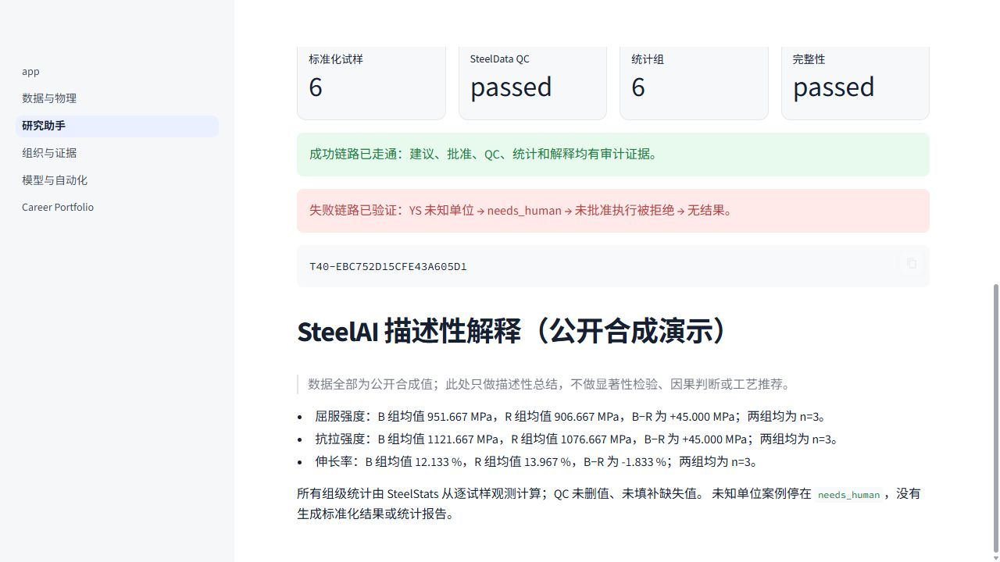

# T40 端到端旗舰演示

## 目标与状态

T40 把毕业作品的主故事冻结成一个可重复演示：从一份陌生 CSV 出发，经过 Agent 形状的字段建议、明确的人工作决定、SteelData 标准化和 QC、SteelStats 组级描述统计，最后生成 SteelAI 的受限解释。

技术验收和项目负责人最终观看验收均已通过，任务状态为 `Done`。演示不调用本地或云端 AI，结果完全确定；将来接云模型只能替换建议/语言组织层，不能绕过相同契约和人工门禁。

最终自动化记录：Workbench 142 项通过、3 项既有环境条件测试跳过；SteelData 88 项通过；SteelStats 31 项通过。最终演示包 `T40-EBC752D15CFE43A605D1` 含 37 个摘要绑定成果，重放返回 `reused=true`，独立复核为 `passed`。

## 一键运行

前提：`SteelAI-Workbench`、`SteelData`、`SteelStats` 位于同一个 `AI_Projects` 目录，各自已有可用 `.venv`。

1. 双击项目根目录的 `Run_Flagship_Demo.cmd`。
2. 脚本运行 `python -B -m steelai.flagship_demo`。
3. 成功后到 `outputs/flagship_demo/T40-.../summary.md` 查看结果。
4. 也可打开 Workbench，进入“研究助手 → 旗舰演示”。

相同代码和冻结输入会复用已经通过 SHA-256 完整性校验的演示包；同名包若被改动会拒绝覆盖。

## 冻结输入与预期输出

公开合成输入位于 `demo_data/flagship_v1/`：

- `SYN-T40-tensile.csv`：B/R 两组，每组 3 个物理试样，共 6 个试样和 18 条 YS/UTS/EL 观测。
- `success_suggestion.json`：字段与单位完整，初始状态必须是 `candidate`。
- `review_fixture.json`：明确标记为 synthetic-only 的人工作决定夹具，不冒充真实科研批准。
- `SYN-T40-unknown-unit.csv` 与 `unknown_unit_suggestion.json`：YS 单位故意缺失。
- `expected_summary.json`：冻结组数、每组 n 和均值，用于机器验收。

成功案例预期：SteelData QC `passed`；SteelStats 完整性 `passed`；6 个组均为 n=3；SteelAI 只做描述性解释，不做显著性、因果或工艺推荐。

失败案例预期：未知单位建议停在 `needs_human`，执行返回稳定的 `execution_not_approved`，不产生标准化结果或统计报告。

## 结果包与可追溯性

每次结果包包含：冻结输入副本、建议/审批/执行审计链、SteelData 标准结果、SteelStats 四文件输入与可追溯报告、SteelAI 解释、`summary.md`、`demo_manifest.json` 和 `COMPLETE`。

外层 manifest 只写相对路径，并为除自身与完成标记外的每个文件记录 SHA-256；所有中间输出保留 `synthetic=true` 或 `synthetic_fixture` 标签。结果只写被 Git 忽略的 `outputs/`，不会写入正式 `data/processed/`。

## 验收截图

截图展示 6 个标准化试样、6 个统计组、通过的 QC/完整性，以及未知单位被拒绝且无结果的失败链路。图中数值均来自公开合成夹具。

## 演示运行清单

- [x] 输入名称与内容均为公开合成资料。
- [x] Agent 建议创建时没有批准文件，也没有启动执行。
- [x] 成功建议经过独立的人工作决定记录后才执行。
- [x] SteelData 标准化与 QC 通过，源试样标识和单元格证据保留。
- [x] 6 个试样逐一绑定 B/R 研究样品，没有按名称自动猜测。
- [x] SteelStats 从 18 条逐试样观测计算 6 个组，每组 n=3。
- [x] SteelAI 文本明确限制为描述性解释。
- [x] 未知单位案例被实际执行门禁拒绝，且无结果。
- [x] 重放复用已验证包；篡改测试会关闭式失败且不覆盖。
- [x] 项目负责人实际打开页面并确认最终展示口径（2026-09-08）。

## 故障处理

- “找不到独立 Python”：按三个项目各自 README 完成 `.venv` 准备，不能把环境合并后冒充模块边界。
- “同名演示包未通过复核”：保留现场排查；系统不会覆盖。若确认只是本地测试产物，可人工移出 `outputs/flagship_demo/` 后重跑。
- “统计结果与冻结预期不一致”：说明代码、契约或输入已变化，应新开任务解释变化，不能临场改输出。
- “未知单位被执行”：属于必须阻断的安全回归，T40 不得验收。

## 不做

不使用真实机密数据；不临场修改输出；不自动批准；不把 synthetic 结果写入正式科研数据；不把两套子模块环境合并；不把描述统计包装成显著性或因果结论。
