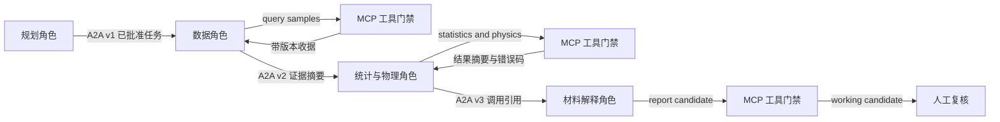

# T61 MCP 工具层与轻量 A2A 协作

## 结论

SteelAI Workbench 已把样品查询、核验证据、描述统计、Physics Card 和候选报告封装为五个受控 MCP 工具，并定义可验证的轻量 A2A 任务信封。实现范围是本地 stdio 和项目内结构化交接，不宣称兼容完整 A2A 网络协议、远程发现、流式传输或厂商扩展。

## MCP 工具清单

| 工具 | 责任角色 | 是否需要任务批准 | 结果边界 |
| --- | --- | --- | --- |
| query_samples | 数据角色 | 否 | 只读样品登记摘要 |
| get_verified_evidence | 数据角色 | 否 | 已核验证据的摘要和版本指纹 |
| run_descriptive_statistics | 统计与物理角色 | 是 | 描述性候选，不做显著性或因果判断 |
| run_physics_calculation | 统计与物理角色 | 是 | 经验模型估算，不是实验测量 |
| generate_report_candidate | 材料解释或审查角色 | 是 | working_candidate，必须人工复核 |

每个工具固定输入和输出 JSON Schema、允许角色、权限名称、超时、错误码、版本、幂等策略，并明确 `formal_result_allowed=false`。未经授权的角色、未知字段、缺失批准或摘要不匹配都会在后端执行前阻断。

## 轻量 A2A 任务信封

任务信封包含任务 ID、修订号、发送角色、接收角色、证据引用、状态、创建和更新时间、结果摘要及整体 SHA-256。证据只传身份、修订和摘要，不传原始内容或本地路径。每次交接生成新修订；旧批准不能用于新修订。

任务批准由任务 ID、修订号和任务摘要共同绑定。AI、Agent、system 或 model 身份不能成为批准人。A2A 信封只传递任务，不授予正式写入或科研结论发布权限。

## 调用链路

每次 MCP 调用生成仅追加治理包，记录任务身份、输入版本、工具版本、权限、超时、请求摘要、结果摘要和错误原因；不保存原始参数，不执行正式写入。

## 幂等与失败关闭

`tool_name + idempotency_key` 形成稳定调用身份。相同输入重复请求复用原收据；同一幂等键绑定不同输入时返回 `GOV-DUPLICATE-001`，不会覆盖既有包。执行超时或后端异常返回 `GOV-RUNTIME-001`，无授权返回 `GOV-AI-AUTH-001`，批准缺失或过期返回 `GOV-APPROVAL-001`。

## 验收演示

`run_t61_handoff_demo` 使用公开合成证据完成规划角色到数据角色、统计与物理角色、材料解释角色的三次结构化任务修订，并运行样品查询、描述统计、物理计算和候选报告四次工具调用。全部产物保持 `formal_result=false` 和 `human_review_required=true`。

MCP stdio 服务入口是 `python -m steelai.research_mcp_server`。`Run_T61_Protocol_Demo.cmd` 用于重放本地合成协议演示和协议自检。

## 已知限制

- 当前只验证本地 stdio MCP 服务，不开放网络端口。
- A2A 是 SteelAI 项目内最小任务信封，不实现远程 Agent 发现、认证联盟、流式消息或推送通知。
- 候选报告只引用工具调用身份，不自动升级为论文结论、正式报告或作品集成果。
- 真实科研数据仍受阶段五来源、单位、身份、QC、人工审批和正式写入门禁约束。
