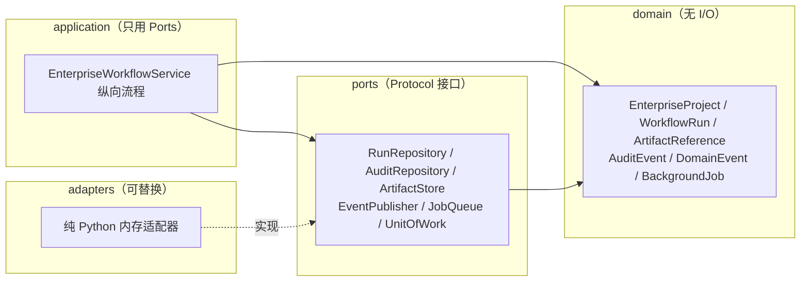

# ADR-0001 Enterprise Lab 企业架构边界

- 状态：`accepted`（2026-09-17 由项目负责人接受；T80 已由 Codex 最终复核通过并转为 `Done`）
- 日期：2026-09-17
- 决策范围：SteelAI Workbench 后续企业化扩展（PostgreSQL、API、后台任务、Kafka、可观测性）
- 相关任务：T80（本 ADR 的引入者）；后续 T81 PostgreSQL 等

## 1. 背景

当前 SteelAI Workbench 的科研主链路已经可用：SteelData 标准化与逐值 QC、CSV/Manifest/SHA-256 完整性包、
共享治理内核（`steelai/governance`）、统一运行中心（`steelai/run_center.py`）和 Streamlit 页面。
项目负责人希望用同一仓库练习企业级架构，并计划逐步引入 PostgreSQL、FastAPI、后台任务、
Transactional Outbox、Kafka 和 OpenTelemetry。

本 ADR 冻结企业化扩展的**边界**，只建立接口骨架，不安装、不接入、不宣称任何外部组件已经可用。

## 2. 决策

### 2.1 当前采用模块化单体，不拆微服务

Enterprise Lab 是单仓库内的一个可选 Python 包（`steelai/enterprise_lab/`），与现有科研代码同进程、
同部署单元，只通过显式接口与领域对象隔离。T80 不引入服务发现、独立部署单元、独立数据库实例或网络调用。

理由：当前规模、单人维护成本和科研可复现性要求都不支持微服务；提前拆分只会把治理规则复制到多进程，
增加不一致风险。ADR 明确拒绝“为了简历拆微服务”的做法。

### 2.2 CSV/Manifest/哈希包继续作为科研证据

现有链路继续是科研证据的唯一载体：

- 治理正式数据仍是 `data/processed/*.csv`（按 `config/research_data_contract_v1.0.json` 主键与关系校验）；
- 结果包仍是 Manifest + 逐文件 SHA-256 + `COMPLETE` 的仅追加目录；
- 统一运行中心继续只读索引这些包，不改变筛选、状态语义和作品集过滤。

Enterprise Lab 不复制、不迁移、不改写任何一份既有 CSV 或结果包，也不建立第二套科研状态机。

### 2.3 PostgreSQL 未来只先承载业务元数据

T81 引入 PostgreSQL 时，第一阶段的表只承载**业务元数据**：项目、运行记录、状态与修订、审计记录、
artifact 引用、任务状态、以及事务性 outbox 记录。科研数值仍留在现有 CSV/结果包中。
Enterprise Lab 的 `RunRepository`、`AuditRepository`、`JobQueue`、`UnitOfWork` 就是为其预留的接口。

### 2.4 大型文件走文件或对象存储，数据库只保存引用和哈希

`ArtifactStore` 的语义被冻结为“只登记相对引用、SHA-256、类型和版本”：

- 数据库只保存 `relative_path` + `sha256` + `artifact_type` + `artifact_version`；
- 大文件（图像、CTF、曲线点表、模型权重）留在现有文件系统、未来的文件服务或对象存储；
- 引用必须是相对 POSIX 路径，绝对路径、盘符、反斜杠、路径穿越、空哈希和非法哈希全部关闭式失败。

### 2.5 Kafka 只用于领域事件

若未来引入 Kafka，它只承载 `DomainEvent`：

- 事件只含 ID、状态、版本、哈希和脱敏摘要，不含原始实验值、绝对路径、密钥或大文件；
- 不用于 RPC，不用于传输大文件，不用于直接执行科研计算；
- 科研计算仍由确定性代码和已登记的外部工具执行，消息中间件不参与计算。

### 2.6 Kafka 接入前必须先实现 Transactional Outbox

顺序不可颠倒：先有本地事务内的 outbox 表（业务写入与事件写入同一事务提交），再有投递器，
最后才是 Kafka。理由：否则会出现“状态已提交、事件已丢失”或“事件已发出、事务回滚”的
双写不一致，而这类不一致会破坏可追溯性。T80 已把该顺序写进 `EventPublisher` 与 `UnitOfWork` 的接口语义与文档。

### 2.7 Enterprise Lab 是可选扩展，现有应用可完全离线运行

- `app.py`、`pages/`、科研计算、治理内核和运行中心**不导入** `steelai.enterprise_lab`；
- 未安装任何企业组件时，模块仍可导入，纵向流程仍可用内存适配器执行；
- 移除该包不需要迁移数据、不需要修改配置、不影响任何既有页面；
- T80 不新增任何第三方依赖，不修改 `requirements.txt` / `requirements-dev.txt`。

### 2.8 Kubernetes、服务网格与云部署不属于 T80

T80 不涉及容器编排、服务网格、密钥管理服务、云数据库、CI/CD 部署流水线和多环境发布。
这些不在本项目当前目标内，也不在 T80 的验收范围内。

## 3. T80 采用的架构

六边形（Ports & Adapters），依赖方向由外向内：

- `domain`：稳定 ID、修订号、状态、创建时间、内容摘要与脱敏规则；不做 I/O，不导入任何外层。
- `application`：只依赖 Ports 和领域对象，在一个 `UnitOfWork` 边界内完成纵向流程。
- `ports`：`typing.Protocol`，由六边形内部拥有；已预留 T81 PostgreSQL、API、后台任务和 Kafka 的替换点。
- `adapters`：目前只有纯 Python 内存实现，用于证明接口可执行。

## 4. 结果与影响

正面结果：企业化扩展有了稳定的、可测试的接口边界；科研链路的默认行为、数据和审批规则不变；
后续引入外部组件时不需要改动科研代码，也不需要在页面层感知数据库或消息中间件。

代价与风险：

- 内存适配器**不是**数据库事务：已提交状态对外唯一可见，回滚不留部分写入，但没有持久性、没有跨进程隔离、没有并发事务，也不支持重叠 UoW（同一 store 同时只允许一个 UoW）；
- 领域对象当前是元数据模型，尚未与 T51 治理包（Manifest/审批/发布器）做正式映射；
- 事件契约尚未与 outbox 表结构对齐，接入 Kafka 前仍需设计投递与重试语义。

## 5. 明确不做的事（T80 非目标）

- 不安装或接入 PostgreSQL、Docker、Kafka、Redis、FastAPI、SQLAlchemy、Alembic、OpenTelemetry；
- 不新增第三方依赖，不修改依赖清单，不创建数据库表或 migration；
- 不增加 Streamlit 页面，不迁移 CSV 数据，不修改科研数据、方法注册表或 T40/v0.2 冻结边界；
- 不实现用户登录、RBAC、HTTP API、后台 worker 或消息消费者；
- 不把尚未实现的 PostgreSQL、Kafka 或微服务写成现有能力。

## 6. 复核要点

Codex 与项目负责人复核时建议确认：

1. `steelai/enterprise_lab/` 的依赖方向是否确实由外向内（`tests/test_t80_enterprise_architecture.py` 有 AST 检查）；
2. 现有应用是否仍然完全不依赖该包（导入隔离测试 + 全量测试）；
3. 事件负载是否确实只含 ID、状态、版本、哈希和脱敏摘要；
4. 内存适配器的事务与幂等契约是否与 T81 的预期一致，特别是已提交状态的唯一可见性、重叠 UoW 的拒绝、仓库句柄的生命周期、request_digest 覆盖范围与任务幂等索引；
5. 本 ADR 的 2.3–2.6 是否与实际将要实施的 T81 范围一致。
